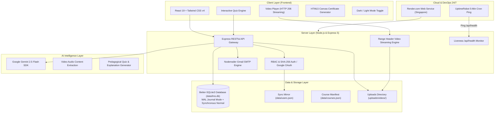
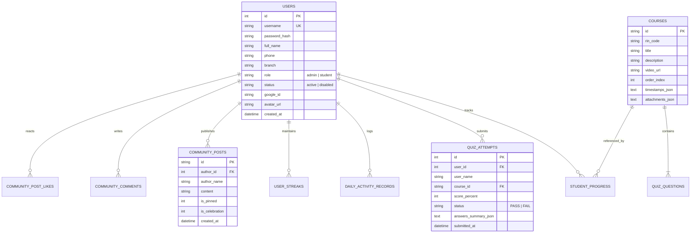
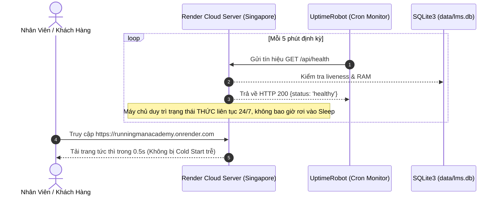

# 🎓 ĐỒ ÁN TỐT NGHIỆP • DỰ ÁN CÔNG NGHỆ THỰC CHIẾN
# 🚀 RMSA - RUNNING MAN SALES ACADEMY
### Hệ Thống Quản Lý Đào Tạo & Sát Hạch Bán Hàng Bất Động Sản Trực Tuyến Tích Hợp AI
*(Enterprise Sales Learning Management System & AI-Powered Assessment Platform)*

---

<p align="center">
  
</p>

<p align="center">
  <strong>Nền tảng đào tạo kỹ năng bán hàng thực địa, sát hạch tuần tự, cấp chứng chỉ số và quản trị nhân sự bất động sản toàn diện.</strong>
</p>

<p align="center">
  <a href="https://runningmanacademy.onrender.com"></a>
  <a href="https://github.com/BryannLee202/web_huong_dan_nv"></a>
  
  
</p>

<p align="center">
  
  
  
  
  
  
  
</p>

---

## 📑 MỤC LỤC
1. [Giới Thiệu Đề Tài](#1-giới-thiệu-đề-tài)
2. [Kiến Trúc Hệ Thống & Cơ Sở Dữ Liệu](#2-kiến-trúc-hệ-thống--cơ-sở-dữ-liệu)
3. [Công Nghệ Cốt Lõi (Tech Stack)](#3-công-nghệ-cốt-lõi-tech-stack)
4. [Các Phân Hệ Chức Năng Cốt Lõi](#4-các-phân-hệ-chức-năng-cốt-lõi)
5. [Trợ Lý Trí Tuệ Nhân Tạo (AI Engine Integration)](#5-trợ-lý-trí-tuệ-nhân-tạo-ai-engine-integration)
6. [Bảo Mật & Phân Quyền (Security & RBAC)](#6-bảo-mật--phân-quyền-security--rbac)
7. [Kiểm Thử & Đảm Bảo Chất Lượng (Quality Assurance & Testing)](#7-kiểm-thử--đảm-bảo-chất-lượng-quality-assurance--testing)
8. [Hướng Dẫn Cài Đặt & Chạy Cục Bộ (Local Setup)](#8-hướng-dẫn-cài-đặt--chạy-cục-bộ-local-setup)
9. [Hướng Dẫn Vận Hành Đám Mây 24/7 (Cloud 0-Cost Operation)](#9-hướng-dẫn-vận-hành-đám-mây-247-cloud-0-cost-operation)
10. [Tài Khoản Quản Trị & Thông Tin Đồ Án](#10-tài-khoản-quản-trị--thông-tin-đồ-án)

---

## 1. GIỚI THIỆU ĐỀ TÀI

### 1.1. Bối cảnh thực tế & Đặt vấn đề
Trong thị trường bất động sản phân khúc căn hộ cho thuê (Studio, Duplex, 1PN-2PN) tại các đô thị lớn (TP.HCM, Hà Nội), tốc độ đào tạo nhân viên kinh doanh (Sales Executive / Telesale) là yếu tố sống còn quyết định doanh thu. Tuy nhiên, các phương pháp đào tạo nội bộ truyền thống gặp nhiều rào cản:
- **Thời gian đào tạo dàn trải:** Mất 2-4 tuần đào tạo trực tiếp gây tốn kém thời gian của Trưởng phòng / Giám đốc kinh doanh.
- **Thiếu tính đo lường định lượng:** Khó kiểm soát nhân viên đã thực sự xem hết video bài giảng hay chưa, mức độ hiểu kịch bản xử lý từ chối giá ra sao.
- **Rơi rụng kiến thức thực chiến:** Khi đi thị trường (dẫn khách xem phòng), nhân viên không có công cụ bỏ túi để tra cứu tức thì kịch bản đối đáp xử lý từ chối.

### 1.2. Mục tiêu nghiên cứu & Giải pháp
Đồ án **RMSA (Running Man Sales Academy)** giải quyết triệt để các bài toán trên bằng cách xây dựng một nền tảng **Microlearning & Automated Assessment** chuyên biệt:
- **Chuẩn hóa 8 chuyên đề bán hàng thực chiến:** Đi từ kỹ năng gọi điện tư vấn 30 giây, kỹ thuật chốt cọc, phân loại nhu cầu khách hàng đến xử lý từ chối giá cao.
- **Cơ chế khóa bài tuần tự nghiêm ngặt (Sequential Locking):** Buộc học viên phải xem video và thi đạt $\ge 80\%$ ở bài trước mới được cấp quyền mở khóa bài tiếp theo.
- **Tự động hóa toàn diện bằng AI:** Tự động nghe video bài giảng, tóm tắt ý chính và sinh bộ đề trắc nghiệm chuẩn sư phạm kèm giải thích chi tiết đáp án.
- **Vận hành không điểm nghẽn 24/7:** Kiến trúc tối ưu chạy trên đám mây với chi phí 0 đồng trọn đời phục vụ đội ngũ 10-50 nhân sự học tập và thi đua đồng thời.

---

## 2. KIẾN TRÚC HỆ THỐNG & CƠ SỞ DỮ LIỆU

### 2.1. Sơ đồ kiến trúc tổng thể (System Architecture)



### 2.2. Thiết kế Cơ sở dữ liệu quan hệ (Entity Relationship Diagram)
Hệ thống sử dụng cơ sở dữ liệu **SQLite 3** hiệu năng cao với cấu hình **WAL (Write-Ahead Logging)** và bộ đệm Prepared Statements in-memory:



---

## 3. CÔNG NGHỆ CỐT LÕI (TECH STACK)

| Phân tầng | Công nghệ | Phiên bản | Vai trò & Đặc tính kỹ thuật |
| :--- | :--- | :--- | :--- |
| **Frontend** | React | 19.2.8 | Xây dựng giao diện Single Page Application (SPA), React Hooks tối ưu hiệu năng |
| | Vite | 8.3.0 | Trình biên dịch siêu tốc, HMR sub-millisecond, Rolldown production bundler |
| | Tailwind CSS | 4.3.3 | Thiết kế Responsive Mobile-First, WinterFrost frosted-glass UI theme |
| | Lucide React | 1.57.0 | Bộ icon vector hiện đại, tối ưu dung lượng SVG |
| | Canvas Confetti | 1.9.4 | Hiệu ứng pháo hoa vật lý chúc mừng khi học viên thi đỗ $\ge 80\%$ |
| **Backend** | Node.js | 24 LTS | Runtime JavaScript môi trường máy chủ chuẩn ES Modules (`type: "module"`) |
| | Express | 5.3.0 | Framework định tuyến RESTful API, xử lý HTTP Request/Response chuẩn Express 5 |
| | Better-SQLite3 | 13.0.3 | Trình quản lý SQLite C++ binding chạy đồng bộ siêu tốc, không block luồng |
| | Multer | 2.4.0 | Xử lý tải tệp tin đa phương tiện lên tới 1GB (Video MP4, WebM) |
| | Nodemailer | 10.1.3 | Module kết nối SMTP gửi mã OTP xác thực email trực tiếp qua Gmail |
| **Trí tuệ nhân tạo** | Google Gemini SDK | 2.30.0 | Tích hợp mô hình ngôn ngữ lớn `gemini-2.5-flash` để tóm tắt và sinh đề thi |
| **DevOps & Cloud** | Render.com | Free Tier | Máy chủ đám mây Node.js tại Singapore, tự động kết nối GitHub CI/CD |
| | UptimeRobot | Free Tier | Dịch vụ giám sát tự động gửi tín hiệu `/api/health` mỗi 5 phút giữ web 24/7 |
| **Kiểm thử & Linter**| Custom Test Suites | ESM Native | 3 bộ kịch bản kiểm thử độc lập bao phủ 653 ca kiểm thử (Backend + SQLite + API) |
| | Oxlint | 1.81.0 | Trình kiểm tra cú pháp và chất lượng mã nguồn siêu tốc từ Rust (0 errors/warnings) |

---

## 4. CÁC PHÂN HỆ CHỨC NĂNG CỐT LÕI

### 4.1. Phân hệ Cổng Đào Tạo & Trình Chiếu Bài Giảng (LMS Player)
- **Giao diện 2 cột thông minh:** Cột trái điều hướng lộ trình 8 chuyên đề, cột phải trình phát video và bộ sát hạch.
- **Truyền phát video chuẩn HTTP 206 (Range Request):** Cho phép học viên tua video tức thì mà không cần tải toàn bộ dung lượng file về máy.
- **Hỗ trợ video đa nguồn:** Phát mượt mà cả video tải lên từ máy tính nội bộ (`/uploads/videos/`), link YouTube embed, video Google Drive và Loom.
- **Dấu mốc thời gian (Video Timestamps):** Tự động điều hướng đến đúng phân đoạn kịch bản khi học viên bấm vào các mốc thời gian trong bài.

### 4.2. Phân hệ Sát Hạch Trắc Nghiệm Tự Động (Quiz Engine)
- **Bộ đề chuẩn hóa:** 10 câu hỏi trắc nghiệm thực chiến cho mỗi chuyên đề đào tạo.
- **Chấm điểm tự động & Hiển thị giải thích chi tiết:** Sau khi bấm nộp bài, hệ thống hiển thị màu xanh/đỏ trực quan cho từng câu, giải thích cặn kẽ vì sao đáp án đó là đúng theo tâm lý khách thuê phòng.
- **Cơ chế Khóa tuần tự (Sequential Progression Lock):**
  $$\text{Điều kiện mở khóa Bài } (N+1) \iff \text{Điểm bài } N \ge 80\%$$
- **Lưu trữ lịch sử thi đấu:** Ghi nhận mọi lần thi (`quiz_attempts`), ngày giờ nộp bài, số câu đúng để phục vụ phân tích năng lực nhân viên.

### 4.3. Phân hệ Sổ Tay Kịch Bản Bỏ Túi (Cheatsheet Drawer)
- Tích hợp hơn 30 tình huống thực chiến:
  - *Xử lý từ chối giá cao:* Công thức chia nhỏ $500.000đ = 16.000đ/\text{ngày}$.
  - *Kỹ thuật chốt cọc giả định (Assumptive Close).*
  - *Kịch bản Telesale 30 giây đầu tiên.*
- Hỗ trợ học viên tra cứu nhanh ngay trên điện thoại khi đang đứng tư vấn trực tiếp với khách thuê tại tòa nhà.

### 4.4. Phân hệ Thước Phim Thực Địa & Mạng Xã Hội Báo Cọc (Reels & Community)
- **Thước phim thực địa (Field Reels):** Tích hợp video dọc mô phỏng TikTok và Facebook Reels giúp nhân viên xem cận cảnh cách quay video phòng mẫu duplex, studio đẹp mắt.
- **Cộng đồng báo cọc vinh danh:** Nhân viên đăng tin chốt cọc thành công, đính kèm số tiền hoa hồng, toàn đội ngũ có thể thả tim và để lại lời chúc mừng.

### 4.5. Phân hệ Bảng Vàng & Cấp Chứng Nhận Tốt Nghiệp (Leaderboard & Certification)
- **Bảng Vàng học viên (Leaderboard):** Xếp hạng thi đua dựa trên điểm số trung bình, số chuyên đề hoàn thành và chuỗi ngày rèn luyện (Streak).
- **Chứng nhận tốt nghiệp (Dynamic Certificate):** Vẽ trực tiếp bằng công nghệ HTML5 Canvas với hoa văn bảo mật, tên học viên, ngày tốt nghiệp và mã QR bảo chứng có thể tải về dạng ảnh PNG hoặc in ấn trực tiếp.

### 4.6. Phân hệ Trung Tâm Quản Trị Hệ Thống (Admin Studio)
- Dành riêng cho Ban Quản Trị và Giám Đốc Đào Tạo:
  - **Quản lý chuyên đề:** Thêm mới, chỉnh sửa, sắp xếp lại thứ tự bài giảng.
  - **Quản lý ngân hàng câu hỏi:** Thêm/sửa câu hỏi trắc nghiệm, các lựa chọn A/B/C/D và lời giải thích.
  - **Giám sát nhân sự thời gian thực:** Xem danh sách học viên, tiến độ hoàn thành, điểm trung bình từng bạn, lịch sử từng bài thi.
  - **Xuất báo cáo Excel / CSV:** Trích xuất kết quả thi toàn doanh nghiệp phục vụ đánh giá năng lực thử việc.
  - **Sao lưu & Khôi phục 1-Click:** Xuất/nhập file cấu hình hệ thống đảm bảo an toàn dữ liệu tuyệt đối.

---

## 5. TRỢ LÝ TRÍ TUỆ NHÂN TẠO (AI ENGINE INTEGRATION)

Hệ thống tích hợp trực tiếp SDK chính thức `@google/genai` với mô hình **Gemini 2.5 Flash**:
1. **Phân tích nội dung Video:** Tự động trích xuất nội dung kịch bản từ bài giảng video hoặc tài liệu huấn luyện.
2. **Soạn đề trắc nghiệm tự động (Auto Quiz Generation):** Sinh bộ câu hỏi tình huống thực chiến từ 5 đến 10 câu hỏi, tự động xây dựng đáp án đúng, 3 phương án gây nhiễu và phần phân tích tâm lý khách hàng cho lời giải thích.
3. **Tóm tắt bài học (Executive Summary):** Chắt lọc 3-5 gạch đầu dòng cốt lõi (Key Takeaways) giúp học viên nắm nhanh kiến thức trọng tâm trước khi vào làm bài thi.

---

## 6. BẢO MẬT & PHÂN QUYỀN (SECURITY & RBAC)

- **Mã hóa mật khẩu chuẩn quốc tế:** Sử dụng thuật toán băm **SHA-256 kèm Salt** chống tấn công bảng băm (Rainbow Table).
- **Phân quyền 2 tầng nghiêm ngặt (Role-Based Access Control):**
  - `admin`: Toàn quyền quản trị chuyên đề, xóa dữ liệu rác, xem báo cáo toàn hệ thống, ghim bài viết.
  - `student`: Quyền học tập, làm bài thi, xem chứng nhận cá nhân, trao đổi trong cộng đồng.
- **Đăng nhập Google OAuth 2.0 Thật 100%:** Xác thực tài khoản Google trực tiếp từ Google Cloud Console.
- **Xác thực 2 bước bằng OTP:** Hỗ trợ gửi mã xác thực ngẫu nhiên qua Gmail SMTP phục vụ quy trình lấy lại mật khẩu và đăng ký an toàn.
- **Cơ chế phòng thủ:** Tự động bảo vệ tài khoản Root Admin không thể bị xóa bởi bất kỳ lệnh API nào.

---

## 7. KIỂM THỬ & ĐẢM BẢO CHẤT LƯỢNG (QUALITY ASSURANCE & TESTING)

Hệ thống được kiểm thử tự động toàn diện qua 3 bộ kịch bản kiểm thử độc lập, đảm bảo tỷ lệ vượt qua **100%**:

```
======================================================================
TỔNG HỢP KẾT QUẢ KIỂM THỬ TOÀN DỰ ÁN RMSA (TEST SUMMARY)
======================================================================
1. tests/test-backend.js          : 601 / 601 TESTS PASSED (100%)
2. tests/test-sqlite.js           :  43 /  43 TESTS PASSED (100%)
3. tests/test-api-and-routes.js   :   9 /   9 TESTS PASSED (100%)
----------------------------------------------------------------------
TỔNG CỘNG                         : 653 / 653 TESTS HOÀN HẢO (100%)
LINTER (Oxlint 49 files)          :   0 ERRORS, 0 WARNINGS
PRODUCTION BUILD (Vite 8)         :   SUCCESSFUL (513ms)
======================================================================
```

### Các nhóm kiểm thử tiêu biểu:
- Logic tính điểm và điều kiện mở khóa bài học tuần tự ($\ge 80\%$).
- Toàn vẹn dữ liệu quan hệ trong SQLite (Transactions, Foreign Keys).
- Cơ chế bảo vệ và chặn xóa tài khoản Root Admin.
- Xử lý Range Request HTTP 206 khi truyền phát video lớn.
- Khôi phục phiên làm việc và bảo toàn trạng thái URL qua Deep-linking (`#/bai-hoc/bai-x`).

---

## 8. HƯỚNG DẪN CÀI ĐẶT & CHẠY CỤC BỘ (LOCAL SETUP)

### Yêu cầu môi trường
- **Node.js:** Phiên bản `v18.0.0` trở lên (Khuyến nghị `Node.js v22` hoặc `v24 LTS`).
- **NPM:** Phiên bản `v9.0.0` trở lên.
- **Hệ điều hành:** Hỗ trợ Windows 10/11, macOS, Ubuntu Linux.

### Các bước cài đặt chi tiết:

1. **Clone mã nguồn từ GitHub:**
   ```bash
   git clone https://github.com/BryannLee202/web_huong_dan_nv.git
   cd web_huong_dan_nv
   ```

2. **Cài đặt các gói thư viện phụ thuộc:**
   ```bash
   npm install
   ```

3. **Cấu hình biến môi trường:**
   Tạo file `.env` tại thư mục gốc (sao chép từ `.env.example`):
   ```bash
   cp .env.example .env
   ```
   *Cấu hình các tham số cần thiết (hoặc để mặc định để chạy thử nghiệm):*
   ```ini
   PORT=5000
   ADMIN_SECRET_KEY=RIN-2005
   # Cấu hình Google Gemini AI (Lấy miễn phí tại: https://aistudio.google.com/app/apikey)
   GEMINI_API_KEY=your_gemini_api_key_here
   ```

4. **Khởi chạy hệ thống ở môi trường phát triển (Development):**
   ```bash
   npm run dev
   ```
   Hệ thống sẽ đồng thời khởi chạy:
   - **Backend Server:** `http://localhost:5000` (Node.js API & SQLite)
   - **Frontend App:** `http://localhost:3000` (React Vite SPA)

5. **Chạy kiểm thử tự động toàn dự án:**
   ```bash
   node tests/test-backend.js
   node tests/test-sqlite.js
   node tests/test-api-and-routes.js
   ```

6. **Đóng gói biên dịch Production:**
   ```bash
   npm run build
   ```

---

## 9. HƯỚNG DẪN VẬN HÀNH ĐÁM MÂY 24/7 (CLOUD 0-COST OPERATION)

Dự án được thiết kế theo kiến trúc tối ưu chi phí **0 đồng / tháng** triển khai thực tế trên **Render.com** kết hợp **UptimeRobot**:



1. **Máy chủ đám mây (Render.com):**
   - Loại dịch vụ: **Web Service (Instance Free)**.
   - Khu vực: **Singapore** (gần Việt Nam nhất, độ trễ $< 40\text{ms}$).
   - Build Command: `npm install && npm run build`
   - Start Command: `npm start`
2. **Cơ chế giữ web không ngủ (UptimeRobot):**
   - Tạo Monitor dạng `HTTP(s)` trỏ tới endpoint:
     `https://runningmanacademy.onrender.com/api/health`
   - Chu kỳ kiểm tra: **5 minutes** (5 phút/lần).
   - Tác dụng: Ngăn máy chủ rơi vào chế độ ngủ đông (Spin down), bảo đảm tốc độ phản hồi tức thì 24/24.

---

## 10. TÀI KHOẢN QUẢN TRỊ & THÔNG TIN ĐỒ ÁN

### 10.1. Thông tin đăng nhập mặc định (Hệ thống sạch đã bàn giao)

| Vai trò | Tên đăng nhập | Mật khẩu mặc định | Quyền hạn |
| :--- | :--- | :--- | :--- |
| **Root Admin** | `admin@runningman.vn` *(hoặc `admin` / `0376604616`)* | `123456` | Toàn quyền Quản trị viên, Quản lý chuyên đề, Xem toàn bộ báo cáo, Giám sát nhân sự |
| **Học viên mới** | Tự đăng ký trực tiếp trên giao diện | Do học viên đặt | Học tập, thi sát hạch, vinh danh báo cọc, nhận bằng tốt nghiệp |

### 10.2. Cấu trúc thư mục mã nguồn

```
web_huong_dan_nv/
├── data/                               # Cơ sở dữ liệu & Cấu hình
│   ├── lms.db                          # SQLite Database chính thức (WAL mode)
│   ├── database.js                     # Tầng dữ liệu & 25+ Database Controller functions
│   ├── users.json                      # Bản sao lưu tài khoản người dùng
│   └── courses.json                    # Cấu hình 8 chuyên đề, kịch bản & bộ đề trắc nghiệm
├── src/                                # Mã nguồn Frontend React 19
│   ├── components/                     # Các module giao diện nghiệp vụ
│   │   ├── MapStudyTeacherPage.jsx     # Trang chủ WinterFrost Portal & Cổng khóa học
│   │   ├── MapStudyLoginPage.jsx       # Modal Đăng nhập / Đăng ký / Google OAuth
│   │   ├── Header.jsx                  # Thanh điều hướng trên máy tính & điện thoại
│   │   ├── Sidebar.jsx                 # Cột lộ trình bài học và tiến độ tuần tự
│   │   ├── VideoPlayer.jsx             # Trình phát video độ nét cao đa nguồn
│   │   ├── QuizEngine.jsx              # Động cơ sát hạch trắc nghiệm & pháo hoa
│   │   ├── KeyTakeaways.jsx            # Tóm tắt kịch bản cốt lõi bài học
│   │   ├── CheatsheetDrawer.jsx        # Sổ tay kịch bản xử lý từ chối bỏ túi
│   │   ├── LeaderboardModal.jsx        # Bảng Vàng vinh danh học viên xuất sắc
│   │   ├── CertificateModal.jsx        # Bộ phát hành bằng chứng nhận Canvas kèm QR
│   │   ├── AdminModal.jsx              # Studio Quản trị khóa học, bài thi & nhân sự
│   │   ├── ThemeToggle.jsx             # Nút chuyển đổi giao diện Ngày & Đêm
│   │   └── ...
│   ├── App.jsx                         # Bộ định tuyến SPA Router & State Manager
│   └── main.jsx                        # Điểm khởi tạo ứng dụng React
├── tests/                              # Bộ kiểm thử tự động toàn diện
│   ├── test-backend.js                 # 601 ca kiểm thử nghiệp vụ & bảo mật
│   ├── test-sqlite.js                  # 43 ca kiểm thử toàn vẹn dữ liệu SQLite
│   └── test-api-and-routes.js          # 9 ca kiểm thử Endpoints & REST API
├── scripts/                            # Tiện ích tự động hóa & sao lưu
│   └── backup-db.js                    # Script sao lưu cơ sở dữ liệu định kỳ
├── uploads/videos/                     # Thư mục lưu trữ video bài giảng tải lên
├── server.js                           # Máy chủ Node.js Express API & Streaming
├── package.json                        # Khai báo gói thư viện & Scripts
└── README.md                           # Tài liệu thuyết minh đồ án chính thức
```

### 10.3. Thông tin thực hiện đồ án
- **Đơn vị bảo trợ chuyên môn:** Running Man Sales Academy (RMSA).
- **Huấn Luyện Viên Trưởng & Cố Vấn Nghiệp Vụ:** Đan Rin.
- **Tác Giả & Nhà Phát Triển:** Lê Minh Tài ([@BryannLee202](https://github.com/BryannLee202)).
- **Giấy phép bản quyền:** [MIT License](LICENSE).

---

<p align="center">
  <strong>© 2026 RMSA (Running Man Sales Academy). All rights reserved.</strong><br>
  <em>Hệ Thống Đào Tạo Bán Hàng Thực Chiến Đỉnh Cao Cho Doanh Nghiệp Bất Động Sản.</em>
</p>
